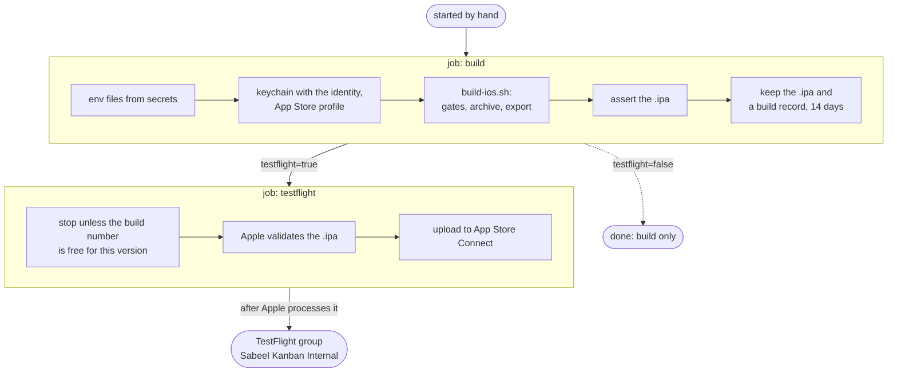

# iOS — building, TestFlight, App Store

The app is one Expo codebase on **three** surfaces: web, Android and iOS.
This file is the iOS half. Release builds and TestFlight uploads run on GitHub
(§ Builds on GitHub); the rest is for whoever works on the Mac — including a
Claude Code instance there, which will not have the context of the session that
set this up.

Read the two rules under "Before you touch anything" first. Both destroy work
silently, and neither announces itself.

## Before you touch anything

### 1. NEVER run a bare `npx expo prebuild`

```
npx expo prebuild --platform ios      # correct
npx expo prebuild                     # DESTROYS app/android/
```

`prebuild` defaults to **clean**, and clean means *delete the native folder and
regenerate it* — `--no-clean` is the opt-out, not the other way round. It clears
only the platforms named by `--platform`, so scoping it is what makes it safe.

`app/android/` is **committed and hand-edited**. It carries `minSdkVersion 33` in
`app/android/app/build.gradle`, set deliberately (it is what lets the photo
picker be permission-free and both storage permissions be dropped). A bare
prebuild regenerates that file from Expo's template and the floor silently falls
back to Expo's default. Nothing fails; you find out when a permission you removed
is needed again.

There is a backstop — prebuild bails on a dirty git tree when it would delete an
existing native folder — but a clean tree is exactly when you are most likely to
run it, so do not rely on that.

### 2. `app/ios/` is a BUILD PRODUCT and is gitignored

Nothing you change in Xcode's UI survives. Capabilities, build settings, Info.plist
edits, signing tweaks — all live in `app/ios/`, which is regenerated by the next
prebuild and is not in git.

**Everything that must persist goes in `app/app.json`**, which is the single
source of truth for the native project. If you find yourself fixing something in
Xcode, stop and ask whether it can be expressed in `app.json` instead. If it
genuinely cannot, write it down in this file so the next regeneration can redo it.

This asymmetry with Android is deliberate: `android/` is committed *because* it
has hand edits that predate this; `ios/` has none, so it stays derivable.

## What is already configured

`app/app.json` carries the iOS block:

| Key | Value | Why |
|---|---|---|
| `ios.bundleIdentifier` | `com.sabeelinstitute.kanban` | matches `android.package` |
| `ios.buildNumber` | integer string | Apple requires it to INCREASE on every upload within a version |
| `ios.supportsTablet` | `false` | phone-first product; the wide layout exists for desktop web |
| `ios.googleServicesFile` | `./GoogleService-Info.plist` | committed, like `google-services.json` |
| `ios.config.usesNonExemptEncryption` | `false` | answers export compliance up front |
| `@react-native-google-signin/google-signin` | registered **bare**, no options | see below — this is deliberate |

### The Google Sign-In plugin takes NO options, on purpose

Most guides tell you to pass `{ "iosUrlScheme": "com.googleusercontent.apps.…" }`,
copied out of the plist by hand. Do not. Registered as a plain string, the plugin
takes its other branch (`IOSConfig.Google.withGoogle`) and reads
`REVERSED_CLIENT_ID` **out of `GoogleService-Info.plist` itself**, so the value
exists in exactly one place and cannot drift from the file it came from.

Passing options also breaks the **web** build, not just iOS: the plugin validates
its options when the config is *resolved*, which happens on every platform, so a
wrong or placeholder scheme fails `expo export --platform web` and takes CI with
it. `npm run check:ios` asserts the plugin stays bare for this reason.

**There is deliberately no `ios.version`.** It would override the root `version`
and give Apple a different number than Android and web. `scripts/check-version.mjs`
already constrains `expo.version` to Apple's `X.Y.Z` shape — three integers, no
suffix, no leading zeros — so the override buys nothing and can only drift. If a
guide tells you to add `ios.version`, it is a guide for a project whose version
scheme is not already store-legal. Ours is.

## `npm run check:ios` — run it before every build

`scripts/check-ios-config.mjs` asserts the things that fail late and expensively:

- the plist exists, and its `BUNDLE_ID` matches `app.json`
- its `PROJECT_ID` matches `google-services.json` — iOS and Android must be two
  apps in **one** Firebase project, not one app in each of two projects
- the plist actually carries a `REVERSED_CLIENT_ID`, and the google-signin plugin
  is registered bare so that value stays the only copy
- export compliance is answered, `buildNumber` is numeric, there is no
  `ios.version`
- the icon is 1024x1024 **with no alpha channel** — Apple rejects transparency at
  UPLOAD, after the archive is built and signed

Two of these are worth spelling out because the symptom does not point at the
cause:

**Wrong `iosUrlScheme` (or missing).** Safari opens, you pick your Google
account, and the app never comes back. No error, no crash — the OS has nothing
registered to hand the callback to, so it simply does nothing. `webClientId` in
`app/src/auth/google.ts` stays as it is; on iOS the library reads its own client
ID out of the plist.

**Bundle id mismatch between the plist and `app.json`.** Firebase reads the plist,
finds it describes a different app, and sign-in fails in ways that look like a
network or credential problem. Firebase **cannot rename a bundle id** — the fix
is always a new iOS app registration and a fresh plist.

## First build on the Mac

### Tooling a fresh Mac does NOT have, and why `brew` cannot supply it

**`/opt/homebrew` is owned by a different account on this machine** — mode 775,
group `admin`, and the working account is not in `admin` — so every
`brew install` fails with a message about changing ownership that reads like a
fixable warning and invites a `sudo chown` of a shared prefix. **`npm`'s global
prefix is that same unwritable `/opt/homebrew`**, so `npm i -g` fails the same
way. The answer in both cases is `~/.local`: the account owns it and it is
already first on `PATH`.

None of this is needed to ARCHIVE — `build-ios.sh` needs only Xcode and the
two gitignored env files (`docs/SECRETS.md`). This is what the LOCAL DEV LOOP needs,
and every row was discovered by something failing:

| Tool | Why it is needed | How, without brew |
|---|---|---|
| **Firebase CLI** | `emulators.sh` and `test-emulator.sh` invoke a bare `firebase` | `npm config set prefix ~/.local && npm i -g firebase-tools` |
| **Playwright browsers** | `seed-dev.mjs` seeds by *driving the web app*; `playwright` is already a devDependency, only its binaries are absent | `npx playwright install chromium` |
| **JDK 21** | the Firestore and Auth emulators are Java | already on the machine at `/opt/homebrew/opt/openjdk@21` — point `SK_JDK21_HOME` at it (`emulators.sh` reads it) |
| **`idb`** *(optional)* | scripting the simulator's UI; `simctl` has no tap primitive | prebuilt `idb-companion.universal.tar.gz` from the idb releases into `~/.local/opt`, plus `uv tool install fb-idb --python 3.11` |

Four traps, each of which cost real time:

- **`expo run:ios` exits 1 on a perfectly good build.** Its last act is
  `ensureSimulatorAppRunning`, which shells out to `osascript` to raise the
  Simulator window — and AppleScript automation is not permitted from a non-GUI
  shell. The app is compiled, signed and installed well before that. `dev.sh ios`
  therefore tolerates the exit code and **verifies the install** instead.
- **`idb_companion` must be launched by its real path, never a symlink.** It
  resolves its sibling `Frameworks/` through `@rpath`, and a symlink on `PATH`
  breaks that. Use a wrapper script that `exec`s the real binary.
- **`IDB_COMPANION` is a socket address, not a path to the binary.** Pointing it
  at the executable gives `Socket operation on non-socket`. Run
  `idb_companion --udid <UDID>`, read the `grpc_port` it prints, then
  `idb connect localhost <port>`.
- **This Mac's Homebrew Python ships without `ensurepip`**, so `python3 -m venv`
  cannot bootstrap pip at all. `uv` avoids the problem and can pin the
  interpreter version a package actually supports.

### The local loop

```bash
scripts/dev.sh ios          # or: npm run dev:ios
scripts/dev.sh ios --build  # compile and install first
scripts/dev.sh stop         # stop what dev.sh started; never Metro or idb
```

It stops everything, starts the emulators, the web server and Metro, seeds,
boots the simulator and launches the app. **The web server is started even
though nothing on iOS reads it** — `seed-dev.mjs` drives the web app in a
browser to create its data, so no web server means no seed and a simulator that
comes up signed in to an empty project.

Emulator data is in-memory and discarded on stop, so re-seeding is normal rather
than a sign something broke.

### Two files a fresh clone does NOT have

Both are gitignored, and neither failing announces itself:

- **`app/.env.local`** — carries `EXPO_PUBLIC_SENTRY_DSN_NATIVE`,
  `EXPO_PUBLIC_SENTRY_DSN_WEB` and `EXPO_PUBLIC_FCM_VAPID_KEY`. Copy it across
  out of band (it is deliberately not in git so a fork does not inherit this
  project's Sentry quota). Without it the build **succeeds** and `initErrorReporting()`
  returns early on a missing DSN — so the app ships with crash reporting silently
  switched off, and nothing anywhere says so. `EXPO_PUBLIC_*` is inlined at bundle
  time, so it must be present *before* the build, not added later.

  **`npm run check:ios` now refuses to pass without it**, and `build-aab.sh`
  refuses to build — deliberately, even though the value only matters for release
  builds. Only `EXPO_PUBLIC_SENTRY_DSN_NATIVE` is needed for iOS; the other two
  are web-only. Get the DSN from Sentry -> the mobile project -> Client Keys.
- **`app/src/build-info.ts`** — generated, and `npm ci` creates it via the root
  `prepare` script. It is what puts the version and commit on the sign-in screen.
  It records the commit at the moment it runs, so **re-run
  `node scripts/gen-build-info.mjs` right before archiving**, or a TestFlight
  build will name whatever commit was checked out when you last installed.

  This is not hypothetical: a device check on 2026-08-12 read `v0.7.5 · ff5bb42`
  off a build serving current source, because a bare `expo start` does not
  regenerate the file. Everything about the running app looked right.

### Three Sentry values, and how they reach an Xcode build

`@sentry/react-native/expo` is registered **bare** in `app.json`, so it reads all
three at build time rather than from a committed file — this repo is public, and
the plugin writes whatever options it is given straight into
`ios/sentry.properties`.

```
SENTRY_ORG=<org slug>            # Sentry -> Settings -> the org URL slug
SENTRY_PROJECT=<native project>  # the React Native project, shared with Android
SENTRY_AUTH_TOKEN=<token>        # an ORG token, scope org:ci — see docs/SECRETS.md
```

**EXPORTING THEM IN YOUR SHELL DOES NOT REACH XCODE.** Xcode's build system runs
Run Script phases in a sanitised environment, and since Xcode 15 it no longer
inherits the environment of a terminal that launched it either — so
`export …; open ios/*.xcworkspace` looks right and silently changes nothing. The
symptom is the one this whole area specialises in: the archive succeeds and
uploads no symbols.

Two ways that actually work. Pick by how you are building:

- **Archiving in the Xcode GUI — fill in `app/ios/sentry.properties`.** The
  plugin generates that file at prebuild with `# no org found, falling back to
  SENTRY_ORG environment variable` in place of each value; replace those lines:

  ```properties
  defaults.url=https://sentry.io/
  defaults.org=<org slug>
  defaults.project=<native project>
  auth.token=<token>
  ```

  Safe **only because `app/ios/` is gitignored and regenerated** — it is a build
  product on a build machine, not repo config. That is also the catch: **every
  `expo prebuild` rewrites it**, so re-fill it after each one. This is the
  difference between a generated file on the Mac and an option in `app.json`,
  which would be committed to a public repo.

- **Archiving from the command line** — `xcodebuild` *does* inherit the shell, so
  plain `export`s work:

  ```bash
  export SENTRY_ORG=… SENTRY_PROJECT=… SENTRY_AUTH_TOKEN=…
  xcodebuild -workspace app/ios/*.xcworkspace -scheme <scheme> \
             -configuration Release archive -archivePath build/kanban.xcarchive
  ```

  This is also the shape any CI job would take, so it is worth being the one you
  learn.

**The token is a real secret.** Never commit it, never paste it in chat, and do
not pass it as an `authToken` plugin option — the plugin itself warns that doing
so writes it into the application package.

Missing, the Xcode build **succeeds and uploads no debug symbols**, so the first
evidence is a crash report full of hex addresses weeks later. `npm run check:ios`
warns when they are absent rather than failing, because only the archiving
machine needs them.

**The same three variables serve Android**, so the two platforms are at parity
and there is one set of names to remember. They get there by a different
mechanism — `app/android/app/build.gradle` applies `sentry.gradle` when
`SENTRY_AUTH_TOKEN` is set — because a config plugin runs at `prebuild` and that
folder is committed and never prebuilt. `scripts/build-aab.sh` warns when they
are missing, exactly as `check:ios` does here. Full reasoning in
`docs/SECRETS.md`.

### Archiving over ssh needs the login keychain unlocked

The archive gets past prebuild, `pod install` and sixty-odd compiled targets,
then dies at the first framework it signs:

```
Code Signing …/SabeelKanban.app/Frameworks/ExpoFileSystem.framework
  with Identity Apple Development: Created via API (…)
…/ExpoFileSystem.framework: errSecInternalComponent
** ARCHIVE FAILED **
```

Nothing there names a keychain. The login keychain unlocks at **GUI login**, and
an ssh session never has one — `launchctl managername` answers `Background`, not
`Aqua`. codesign can still READ a certificate, which is public data, so
`security find-identity -v -p codesigning` lists valid identities while every one
of them is unusable. The tell is one command:

```console
$ security show-keychain-info ~/Library/Keychains/login.keychain-db
security: SecKeychainCopySettings …: User interaction is not allowed.
```

The fix is one more, typed at the prompt rather than passed with `-p`, which
would put an account password in shell history:

```bash
security unlock-keychain ~/Library/Keychains/login.keychain-db
```

The unlock is shared by every process of that user, so doing it in another
terminal is fine. It is **runtime state**: it does not survive a reboot, and no
one logs into this Mac's console as the build account, so it starts locked every
time. Once open it stays open — `show-keychain-info` then reads `no-timeout`,
with no lock-on-sleep.

Proving it costs a second rather than a rebuild, because signing anything
exercises the same mechanism as signing a framework:

```bash
cp /bin/echo /tmp/probe && codesign --force --sign <identity> /tmp/probe
```

`npm run build:ios -- --check` does exactly that, so this now fails in two
seconds. If the keychain is open and signing still fails, the cause is the
private key's ACL refusing a session with no window server, which an unlock does
not touch:

```bash
security set-key-partition-list -S apple-tool:,apple:,codesign: -s <keychain>
```

### Then — one command, no Xcode UI

```bash
git pull
npm ci                                  # also generates build-info.ts
# copy app/.env.local and app/.env.sentry-build-plugin into place
npm run build:ios -- --check            # every gate, builds nothing
npm run build:ios                       # archive, export, upload to TestFlight
```

`scripts/build-ios.sh` does the whole thing: gates, `gen-build-info`,
`expo prebuild --platform ios`, `pod install`, `xcodebuild archive`, then export
with `destination: upload` so it goes straight to App Store Connect. No
Organizer, no Transporter, no signing dialog — `-allowProvisioningUpdates` with
an App Store Connect API key lets Xcode fetch the signing assets itself. That is
the Mac's **automatic** signing; a GitHub runner signs **manually** instead
(see "Builds on GitHub").

`--check` is free and runs every gate. Use it first; it catches a missing team
id, a missing API key, an absent deploy-log entry or a locked signing keychain in
two seconds rather than twenty minutes into an archive.

**It refuses to run anywhere but macOS**, and the prebuild inside it is always
`--platform ios`, so it cannot be the thing that deletes `android/`.

Expo 57 / React Native 0.86, so a current Xcode and CocoaPods are assumed; if the
toolchain is too old `pod install` is where it surfaces.

Worth doing once by hand before the first upload: build to a **simulator** and
sign in. Google Sign-In opens a web session and returns through the URL scheme,
which is the single most likely thing to be misconfigured, and the simulator can
prove it. Push cannot be proved there — see below.

```bash
cd app && npx expo run:ios      # simulator, debug
```

### The push entitlement survives the prebuild, and it is not Xcode that does it

This was open until 2026-08-15 and is now answered, because the answer is not
what the question assumed. **Nothing in Xcode is involved, and nothing needs to
go under `ios.entitlements`.**

`expo-notifications` ships an `app.plugin.js`, so its config plugin is applied
**automatically** — which is why it appears nowhere in `expo.plugins` in
`app/app.json` and still runs. On every prebuild it writes the entitlement
itself:

```js
// node_modules/expo-notifications/plugin/src/withNotificationsIOS.ts
if (!config.modResults['aps-environment']) {
  config.modResults['aps-environment'] = mode;   // mode defaults to 'development'
}
```

So a regenerated `ios/` always carries it. Verified by deleting `ios/`,
prebuilding, and reading the file back:

```console
$ cat app/ios/SabeelKanban/SabeelKanban.entitlements
    <key>aps-environment</key>
    <string>development</string>
```

**`development` is correct, and must not be "fixed" to `production`.** The value
in the source entitlements is what a *debug* build signs with, and a development
build signed `production` will not install. The distribution value is applied
later, by the export: `xcodebuild -exportArchive` re-signs against the App Store
provisioning profile and takes the entitlements from it. Reading the same app at
both stages of one build shows the substitution:

| | `aps-environment` | `get-task-allow` |
|---|---|---|
| in the `.xcarchive` | `development` | `true` |
| in the exported `.ipa` | **`production`** | `false` |

Setting `production` by hand in `app.json` would therefore fix nothing, break the
simulator, and be silently overwritten anyway.

The corollary is the useful part: **the entitlement a device enforces exists only
after the export**, so it cannot be checked by reading `app.json`, the
entitlements file, or the archive. Check the `.ipa`:

```bash
npm run build:ios -- --no-upload
unzip -q build/ios/export/SabeelKanban.ipa -d /tmp/ipa
codesign -d --entitlements :- /tmp/ipa/Payload/SabeelKanban.app
```

This says nothing about whether push is *delivered* — see below. It only proves
the build is entitled to receive it, which is the half that can be checked
without a phone, and the half that had never been checked.

### What the `.ipa` can tell you before you upload

`--no-upload` exports the same artifact the uploading run would send, so three of
the device checks can be done here instead — and earlier, which is better, since
a build number cannot be reused once Apple has seen it.

```bash
unzip -q build/ios/export/SabeelKanban.ipa -d /tmp/ipa
/usr/libexec/PlistBuddy -c 'Print :CFBundleVersion' /tmp/ipa/Payload/SabeelKanban.app/Info.plist
```

Two of these are traps, both because the JS bundle is **Hermes bytecode**:

- **Do not grep the bundle for the dev sign-in row.** `strings main.jsbundle`
  finds `Dev sign-in (emulator only)` in a perfectly good release build. Hermes
  keeps a string table, and Metro does not constant-fold across module
  boundaries — `devSignInAvailable = IS_DEV && USE_EMULATORS` imports both
  operands, so the JSX is compiled in and never reached. Within one module the
  folding does happen, which is the tell: `10.0.2.2` is absent from an iOS bundle
  while `127.0.0.1` is present, because `Platform.OS` folds inside `env.ts`.
  What to check instead is the compiled *value* of each gate, from a readable
  export of the same release bundle:

  ```console
  $ cd app && npx expo export --platform ios --no-bytecode --no-minify --output-dir /tmp/js
  $ grep -oE '(IS_DEV|USE_EMULATORS) = [a-z]+' /tmp/js/_expo/static/js/ios/index-*.js
  IS_DEV = false
  USE_EMULATORS = false
  ```

  Both false independently, so the row cannot render. `EXPO_PUBLIC_USE_EMULATORS`
  is absent from `app/.env.local` by design — that is the second gate, and it is
  the one that survives someone getting `__DEV__` wrong.

- **Read the build stamp for a trailing `+`.** `gen-build-info.mjs` appends it
  when the tree is dirty, so `4356b20+` means the build cannot be mapped to any
  commit. It is easy to earn without noticing: fix something in a build script,
  rerun the build, and the artifact is stamped `+` even though the change never
  touched the app. **Commit first, then build** — the same rule the deploy doc
  states for web and Android, and it applies here for the same reason.

### What the simulator cannot tell you

Sign-in **can** be exercised on the simulator: Google Sign-In opens a web session
and comes back through the URL scheme, which is precisely the thing most likely
to be misconfigured.

**Push mostly can** — see "Push on the simulator" below. What it cannot do is
a tap from OUTSIDE the app: a headless simulator's SpringBoard drops synthetic
taps on a home-screen banner or a Notification Center entry, so a tap with the
app in the background or closed, and a cold start from a tap, need a phone.
They reach the same listener as a foreground tap.

### Push on the simulator

An Apple-silicon simulator receives REAL pushes from Apple's sandbox, and a
debug build registers against the emulators like any device, so the iPhone half
of push is provable here, end to end but for the outside tap above:

1. A debug build (`EXPO_PUBLIC_USE_EMULATORS=1`), signed in, and **Enable
   notifications** on the Boards screen, then Allow. It files
   `users/<uid>/pushTokens/<token>` as
   `{ platform: 'ios', apnsEnvironment: 'development', updatedAt }` — through
   the rules, which admit only that shape for an iPhone.
2. Read the token back from the Firestore emulator: it is the row's id, 160 hex
   characters on an iOS 26 simulator.
3. `node scripts/send-test-push.mjs --apple development <token> <boardId> <cardId>`
   with the APNs key at `~/.apns/AuthKey_<APNS_KEY_ID>.p8` (or `APNS_KEY_FILE`).
   It sends exactly what a notification sends, built by the functions' own code.
4. With the app open: a banner. Tap it: the card opens.

Done this way on 2026-10-15: the row filed as above, Apple's sandbox accepted
both sends, the banner showed, and tapping it opened the named card.

The emulated functions never send (`functions/src/messaging.ts`), so a card
assigned in the app does not reach the simulator; step 3 is the delivery.

**On a Mac shared with the sibling apps**, `scripts/dev.sh ios` is the wrong
tool: it needs port 8081 and the simulator named "iPhone 17 Pro", which the
other repos use too (it refuses to start Metro while another holds 8081, and
its `stop` touches neither Metro nor idb). Give the test a simulator of its own (`xcrun simctl create`),
build with `xcodebuild … -sdk iphonesimulator -destination id=<udid>`, install
with `simctl install`, run Metro on a free port
(`EXPO_PUBLIC_USE_EMULATORS=1 npx expo start --port <port> --clear` in `app/`),
and point the debug app at it before launching:
`xcrun simctl spawn <udid> defaults write com.sabeelinstitute.kanban RCT_jsLocation 127.0.0.1:<port>`.
Confirm which Metro the app reached — its own TCP connections
(`lsof -a -p <app pid> -iTCP`) and that Metro's `iOS Bundled … app/index.ts`
line — before trusting anything it shows: a Kanban shell running another
project's bundle looks like a working app.
`npm run check:apple-push` asks Apple whether it accepts the production key for
this app, with a token that cannot exist, and needs no device at all.

`xcrun simctl push` is a different and weaker check: it fakes a payload on the
simulator, proving the app renders and routes one, but not the key, the token or
the service.

## Builds on GitHub

`.github/workflows/ios.yml` builds the app on GitHub's macOS runners, which are
free and unlimited because this repo is public. Builds run automatically on main pushes. To build manually or upload to
TestFlight:

```bash
gh workflow run ios.yml -R Sabeel-Institute/sabeel-institute-kanban                    # build a signed .ipa
gh workflow run ios.yml -R Sabeel-Institute/sabeel-institute-kanban -f testflight=true # build it, then upload it
gh run watch <run id> -R Sabeel-Institute/sabeel-institute-kanban
```

or Actions → iOS → Run workflow, or the REST API:
`POST /repos/Sabeel-Institute/sabeel-institute-kanban/actions/workflows/ios.yml/dispatches`
with `{"ref": "main", "inputs": {"testflight": "true"}}`.

**A build is free to run at any time. An upload is a release** and needs
Faisal's go-ahead like any other (`CLAUDE.md`, Conventions).



**build** writes the two gitignored env files from secrets, imports the
signing identity into a keychain of its own, installs the App Store profile,
and runs `build-ios.sh --no-upload`. It needs no new build number. It then
asserts the exported `.ipa` — the one place the entitlements a device enforces
exist (see "The push entitlement survives the prebuild"): `aps-environment`
`production`, `get-task-allow` `false`, the CI profile embedded, and this
commit's stamp, without a `+`, inside the compiled JavaScript. Its artifacts,
kept 14 days: the `.ipa`, and a build record — the JavaScript source map and
the `Podfile.lock` it installed. Both are downloadable by anyone signed in to
GitHub; neither holds a secret, and an App Store-signed `.ipa` installs only
through Apple.

**The pods are pinned** by the committed `app/Podfile.lock`, which
`build-ios.sh` copies into the generated `app/ios/` before `pod install`, on
the Mac and on GitHub alike. Without it every build resolved the third-party
pods afresh, because prebuild is clean: v0.11.3 build 10 went out from the Mac
with AppCheckCore 11.3.1 and GoogleUtilities 8.1.2, and GitHub resolved 11.3.2
and 8.1.5 seven weeks later, though no npm dependency had changed in between.
The Mac's local copy of the specs index was stale and knew nothing newer, so
`pod install` runs with `--repo-update`; the lock still decides every version.
If `pod install` resolves
anything other than the pin, the build stops. When a native dependency changed
on purpose (an Expo or React Native upgrade, a new native module):
`cp app/ios/Podfile.lock app/Podfile.lock`, commit, and build again. The lock
in a GitHub run's build record is the same file, for a change made without a
Mac.

**testflight** runs only with `testflight=true`. It asks App Store Connect
whether the build number is free for the version (`scripts/testflight-check.mjs`
— if not, it stops in seconds: raise `expo.ios.buildNumber`, commit, run again),
has Apple validate the `.ipa`, and uploads it. The internal group "Sabeel
Kanban Internal" has access to all builds, so testers get it after processing
with no further step.

**A run builds the workflow file AT the ref it is started on.** A commit that
predates `ios.yml` cannot be built from GitHub at all, and a release built here
should be started on its release commit or tag (`--ref vX.Y.Z`), not on a later
main — the sign-in screen displays the commit.

### Two signing modes, chosen by `IOS_PROFILE_NAME`

| | The Mac | GitHub |
|---|---|---|
| Mode | automatic | **manual** (`IOS_PROFILE_NAME`, set by the workflow from the profile) |
| Certificate | cloud-managed, minted through the Admin App Store Connect key at export; never in the keychain | the team's **Apple Distribution: Sabeel Institute** certificate (id `MQ8FC7CJVA`), shared with the LMS and the time tracker |
| Profile | Xcode-managed | **"Sabeel Kanban App Store CI"**, push entitlement `production` |
| Needs the `.p8` to build | yes | no — only the upload does |

Manual signing writes the signing settings into the **app target alone**, with
the `xcodeproj` gem that ships with CocoaPods. Passed on the xcodebuild command
line, `PROVISIONING_PROFILE_SPECIFIER` would reach every pod target too, and
each fails with "does not support provisioning profiles". It passes neither
`-allowProvisioningUpdates` nor the key, so nothing can be minted.

**Never let automatic signing run on a runner.** A fresh machine has no
certificate, so automatic signing creates one every run and throws its private
key away, until Apple's per-team certificate limit stops every build — the
LMS's and the time tracker's too.

Manual mode's gates run in seconds, before prebuild: the profile is installed,
is for `<team>.com.sabeelinstitute.kanban`, has not expired, and carries the
certificate of the keychain's Apple Distribution identity. The last is the
mistake to expect at renewal — a new certificate with the old profile.

### Secrets

| Secret | What | From |
|---|---|---|
| `IOS_DIST_P12`, `IOS_DIST_P12_PASSWORD` | the Apple Distribution certificate with its private key, base64, and its password | Faisal's Linux machine, `~/.config/sabeel-lms/ios-distribution/` (shared with the LMS and the time tracker), and the vault |
| `IOS_PROFILE` | the App Store profile "Sabeel Kanban App Store CI", base64 | the same folder |
| `ASC_KEY_P8` | the App Store Connect API key (Admin) — read by the upload job only | `~/.appstoreconnect/private_keys/` on Faisal's machine and on the Mac |
| `IOS_BUILD_ENV` | `app/.env.sentry-build-plugin`: the Sentry three, `IOS_TEAM_ID`, `ASC_KEY_ID`, `ASC_ISSUER_ID` | the Mac's copy, `NAME=value` lines only, no `ASC_KEY_PATH` |
| `APP_ENV_LOCAL` | `app/.env.local` | the Mac's copy, `NAME=value` lines only |

`app/GoogleService-Info.plist` is committed, so it needs no secret. Everything
in the table is also in Faisal's vault, `~/.config/secrets-vault/`: the signing
files and the key under `sabeel/apple/`, the two env files under
`sabeel/kanban/env/`.

Set one with `gh secret set NAME -R Sabeel-Institute/sabeel-institute-kanban < file`
(`base64 -w0 file | gh secret set NAME …` for the two binary ones). **Keep
comment lines out of the two env secrets**: GitHub masks a multi-line secret
line by line, so a line of `#` turns every `#` in the log into `***`. A line
mask also does not cover a value printed on its own, so the workflow masks each
value by itself before anything runs. The logs are public.

### Renewal, before 16 October 2027

One Apple Distribution certificate signs the GitHub builds of three apps:
`Sabeel-Institute/sabeel-institute-kanban`, `Sabeel-Institute/lms` and
`Sabeel-Institute/sabeel-institute-time-tracker`. It and each app's App Store
profile expire on **16 October 2027**; from then the gates in `build-ios.sh`
stop every GitHub build in seconds with "expired". The Mac signs
automatically and is unaffected.

Renew all of it together, from Faisal's Linux machine, through the App Store
Connect API with the Admin key (`docs/SECRETS.md`; `scripts/testflight-check.mjs`
shows how its token is signed). The current key, certificate, `.p12`, its
password and the App Store profiles are in `~/.config/sabeel-lms/ios-distribution/`
there, and all of them in the vault under `sabeel/apple/ios-distribution/`.

1. A new private key and signing request:
   `openssl req -new -newkey rsa:2048 -nodes -keyout distribution.key -out distribution.csr`.
   `POST /v1/certificates` with `certificateType` `DISTRIBUTION` and the CSR;
   base64-decode the returned `certificateContent` (DER) into `distribution.cer`.
2. For each app's bundle id, `POST /v1/profiles` with `profileType`
   `IOS_APP_STORE`, the bundle id, the new certificate and the profile's
   existing name — this app's is "Sabeel Kanban App Store CI". Save
   `profileContent` as the `.mobileprovision`. A profile carries its App ID's
   capabilities, so the push entitlement comes with it.
3. `openssl x509 -inform der -in distribution.cer -out distribution.pem`, then
   `openssl pkcs12 -export -legacy -inkey distribution.key -in distribution.pem -out distribution.p12`
   under a new password.
4. In **each of the three repos**: `IOS_DIST_P12` (base64 of the `.p12`),
   `IOS_DIST_P12_PASSWORD`, and that app's `IOS_PROFILE` (base64), with
   `gh secret set NAME -R <repo>` as in § Secrets.
5. Replace the files in `~/.config/sabeel-lms/ios-distribution/`, then
   `bash ~/.config/secrets-vault/vault.sh collect`.
6. A build-only run of each repo's `ios.yml`. Its gates check that the profile
   carries the certificate of the keychain's identity — the mistake to expect
   here.
7. Revoke the old certificate (`DELETE /v1/certificates/<id>`): a team may hold
   only a few.

## Four registrations, one bundle id — and they are not each other

`com.sabeelinstitute.kanban` is registered four separate times, across three
consoles. They look like one thing because they share a name, and treating them
as one is how this checklist came to claim the App Store Connect app existed when
only the portal identifier did — noticed when an upload had nowhere to land.

| Registration | Where | What it gets you |
|---|---|---|
| **App ID** (+ capabilities) | developer.apple.com → Identifiers | The bundle id exists and is allowed to use Push. Signing and provisioning profiles are built against it. Without it, nothing can be signed. |
| **APNs key** | developer.apple.com → Keys | The credential Apple accepts for sending push to this team: the functions' `APNS_KEY` secret. |
| **Firebase iOS app** | Firebase console | `GoogleService-Info.plist`, so the SDK knows which project it is. |
| **App Store Connect app** | appstoreconnect.apple.com → Apps | The distribution record: versions, builds, **TestFlight**, App Review, availability. A build has nowhere to upload without it. |

The first three are identity, entitlement and configuration. Only the last is
distribution. **TestFlight is a tab inside that last one** — there is no
top-level TestFlight section, so its apparent absence means the app record is
missing, not that something is broken.

The same split exists on Android and is worth the analogy: the Firebase Android
app and the upload keystore are identity and signing; the Play Console listing is
distribution. Neither creates the other there either.

## App ID capabilities — enable exactly ONE

The Apple Developer portal shows a long list when you register the identifier.
For this app the answer is **Push Notifications, and nothing else.** Leave
whatever Apple ticks by default alone; do not add anything from the list.

Every other capability is a claim about what the app does, and claiming one you
do not use is not free — several trigger extra review questions or require
matching entitlements that then have to be justified.

Three that look like they might apply and do not:

- **Push Notifications → Broadcast.** A sub-option of the one capability we do
  want, so it is easy to tick by reflex. It is for updating **Live Activities**
  at scale through APNs *channels*: one request updates every device subscribed
  to a shared event, like a score or a flight. This app has no Live Activities,
  sends one message per device token (`sendEach`), and — the part that rules it
  out structurally — gives every message that recipient's own inbox id
  (`notifIdByUid.get(r.uid)`). A broadcast payload is identical for all
  subscribers, so it could not carry per-person routing even in principle. Leave
  it off.

- **Background Modes → Remote notifications.** That is for *silent* pushes that
  wake the app to do work. Ours are alert pushes: `functions/src/notifications.ts`
  sends `notification: { title, body }` with a `data` block for routing, never
  `contentAvailable`, and the client registers no background message handler. The
  system displays the alert and the app routes on tap. No background mode needed.
- **Associated Domains.** That is for universal links (`https://` URLs opening
  the app). Routing here goes through the custom `sabeelkanban` scheme, and the
  repo has no `applinks` configuration.

**Sign in with Apple is deliberately NOT enabled.** Guideline 4.8 requires an
equivalent private login option when an app uses a third-party login for the
user's primary account — but it exempts apps where the user signs in with an
existing **education or enterprise** account, which is exactly this: sign-in is
restricted to `@oursabeel.com` and additionally gated on admin approval. Be ready
to say that in review notes rather than to add Apple sign-in reflexively.

## The two `.p8` keys are DIFFERENT keys

They are both `.p8` files, both download exactly once, and both are real secrets
— which is why they get confused. They are not interchangeable.

| | APNs authentication key | App Store Connect API key |
|---|---|---|
| Made in | Apple Developer portal → Certificates, Identifiers & Profiles → **Keys**, with *Apple Push Notifications service (APNs)* enabled | App Store Connect → **Users and Access → Integrations → App Store Connect API** |
| Used by | **the functions**, to send to iPhones directly (`functions/src/apns.ts`) | build tooling, to **upload** builds (fastlane, `xcrun`, CI) |
| Installed at | Secret Manager as `APNS_KEY`; its Key ID and the Team ID in `functions/.env.sabeel-institute-kanban` (`docs/SECRETS.md`) | wherever the upload runs |
| Without it | push silently never arrives on iOS | you cannot upload a build |

Neither belongs in this repo. The App Store Connect key is on the Mac in
`~/.appstoreconnect/private_keys/` and in the `ASC_KEY_P8` secret, which only
the GitHub upload job reads ("Builds on GitHub").

## Getting it to testers, and the login gate

**Internal TestFlight is the channel now; Unlisted App Distribution, after App
Review, is the route** (decided 2026-08-18). The submission, the review account
and every store decision are in `docs/STORE-RELEASE.md`.

- **Internal TestFlight.** Faisal and core developers — people who genuinely
  belong on the App Store Connect team. No Beta App Review; builds land minutes
  after processing. The group **"Sabeel Kanban Internal"** has access to all
  builds, so each upload reaches it with no further step.
- **Unlisted App Distribution.** A normal App Store app that is not searchable
  and appears in no category, chart or recommendation, reachable only by direct
  link. No user cap, all App Store regions, managed and unmanaged devices alike,
  and **no expiry**. Colleagues need no App Store Connect account, no MDM
  enrolment and no redemption code — just the link. Apple asks that an unlisted
  app carry its own access control, and this one does: `@oursabeel.com`-only
  sign-in, enforced server-side, with admin approval on top.

### Adding a tester

1. App Store Connect → **Users and Access** → **+** → their Apple ID email and
   the **Developer** role, limited to this app.
   Internal testers must hold a role on the team (up to 100 people).
2. They accept the emailed invitation and sign in to App Store Connect once.
3. TestFlight → Internal Testing → **Sabeel Kanban Internal** → **Testers** →
   **+** → add them. TestFlight emails them; they install the **TestFlight**
   app on the iPhone, signed in with that Apple ID, and accept.

**Builds expire 90 days after upload.** Build 13 was uploaded 2026-10-16 UTC, so
it expires around 2027-01-14; an upload before then gives the group a newer
build.

### The review account

A reviewer signs in through **Sign in with email** as `apps-reviewer@oursabeel.com`,
an ordinary member of one board of sample cards — never through a Google
Workspace sign-in, whose login challenge a reviewer cannot pass. Its password is in the
vault and goes into App Store Connect's App Review Information
(`docs/STORE-RELEASE.md`).

### What was considered and rejected

- **Apple Business Manager Custom Apps.** Free, but needs a D-U-N-S number, and
  on unmanaged personal devices — which is every device here, there is no MDM —
  it reaches people only through **redemption codes**: a CSV of one-time codes,
  locked to the ABM account's own country, and a mechanism Apple publishes
  migration guidance *away* from. It is also a **one-way door**: an app first
  distributed privately through Business Manager needs a brand-new App Store
  Connect app record before it can be made unlisted. Custom Apps go through App
  Review anyway, so it buys no exemption.
- **Apple Developer Enterprise Program.** Requires **100+ employees** and is
  restricted to cases the App Store, Custom Apps, Ad Hoc and TestFlight cannot
  serve. A team this size does not qualify.
- **TestFlight external testers.** Up to 10,000, invited by email or a public
  link, without App Store Connect accounts, but every build expires after 90
  days and the first build of each version goes through Beta App Review.
- **TestFlight internal testers for the whole team.** No review, but each tester
  must be a **user on the App Store Connect team** — standing access to the
  account that ships the app, for every colleague added.

## Releasing

The iPhone build is part of the one release batch (`docs/DEPLOY.md` § Shipping a
release), and shares its version with the other two surfaces: `expo.version` in
`app/app.json` is the one number, with a `docs/PHASE_STATUS.md` deploy-log entry
headed by it. `scripts/build-aab.sh` and
`scripts/build-ios.sh` both refuse to build without one — the entry covers the
release, not one platform's build.

`ios.buildNumber` is separate and iOS-only: Apple wants it to **increase on every
upload**, even for the same version. Bump it when re-uploading the same version
after a rejection or a bad build; reset thinking is not required — a
monotonically increasing integer is always valid.

Upload with the iOS workflow and `testflight=true`, started on the release tag
("Builds on GitHub"); `npm run build:ios` on the Mac does the same when GitHub
cannot. TestFlight builds appear after processing; because `usesNonExemptEncryption` is
answered, they go to testers without the manual export-compliance prompt.

### The handoff prompt, for a Mac session

The release build and its TestFlight upload run on GitHub. A Claude Code session
on the Mac is for what needs a live Mac — simulator checks, or a build when
GitHub cannot make one — and has none of the context of the session that cut
the release. Paste this, filling in the blanks. It says what not to assume; this
file is the runbook.

```text
You are on the build Mac, in a clone of sabeel-institute-kanban, for
release <TAG>. Read docs/IOS-BUILD.md, all of it, before anything. Two
things in it destroy work silently: a bare `npx expo prebuild` deletes
the committed android/ folder, and app/ios/ is a build product, so
nothing you change in Xcode's UI survives.

Start from the release commit, not from main:
    git fetch --tags && git checkout <TAG>
The sign-in screen displays the commit.

Do not change the version, and upload nothing unless told to: TestFlight
uploads run on GitHub (ios.yml). If you are told to build and upload from
here: app/.env.local and app/.env.sentry-build-plugin are gitignored, so
copy them in first; run `npm run build:ios -- --check` before the
twenty-minute archive; and if Apple refuses the build number, raise
`expo.ios.buildNumber` alone.

Scope: iOS only. Do not touch app/android/, do not commit app/ios/, and
do not deploy hosting, functions or rules.

What to check in this release: <CHECKS>.

Report what you SAW, with screenshots, and the version and commit read
off the sign-in screen — read, not inferred. A negative result from an
instrument that cannot drive the feature is not a result.
```

## Things that are genuinely open

- **A push seen on a real iPhone.** Apple accepts the key for this app
  (`npm run check:apple-push`), and the sandbox path has been seen end to end on
  the simulator ("Push on the simulator"). What only a phone can show is a
  production delivery from a TestFlight install, and a tap with the app in the
  background or closed.
- **iPad.** `supportsTablet` is `false`. If that changes, the phone-first layout
  needs a look at iPad widths — the breakpoint work in `scripts/screens-e2e.mjs`
  covers 320-500px only.
