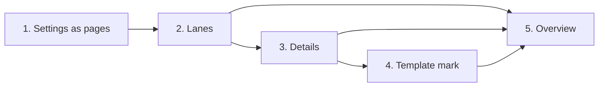

# Plan: lanes, board details, templates and the overview

Written 2026-11-15, against `main` at v0.19.0. Nothing in this plan is built.
Every product decision in it was made by Faisal on 2026-11-15 over five rounds
of a concept page with phone prototypes. That page is private; ask Faisal for
it if a drawing would settle a question this text leaves open.

This document is the hand-off to whoever implements. Read all of it before
writing code, then read `CLAUDE.md` § "The method": its six practices are the
definition of done for every step here, and § 9 below says where each one
bites in this work.

## 0. Where the repo stands

From the session that shipped 0.19.0, checked against the repo on 2026-11-15.

- `main` is at `ef77969`, which is v0.19.0, released on every surface. The
  tree is clean apart from this file, every local branch is merged, and no
  dev server, emulator or AVD is running. The next release is 0.20.0.
- **Help films.** Fourteen are already stale, listed in
  `docs/PHASE_STATUS.md` § Help films that lag the app. This work changes
  more filmed screens. Add each film to that list in the step that changes
  its screen, re-record once after the last step, and publish the set before
  the app ships. Do not re-record per step.
- **A new card field does not reach every screen by itself.** These copy a
  card's fields by hand: `toCard` in `app/src/cards.ts`, `toMyWorkCards` in
  `app/src/myWork.ts`, `packages/shared/src/search.ts` and `SearchScreen`'s
  mapping, `boardClone`, and the seeds in `scripts/seed-emulators.mjs`,
  `scripts/screens-e2e.mjs`, `scripts/tutorials/world.mjs` and
  `scripts/manual-shots.mjs`. In 0.19.0 `parentId` was missed in My Work and
  Search and the subtask chips silently never showed there. `grep -rn
  parentId` finds every such place; decide for each whether `laneId` goes
  there too, and write the answer down (§ 9, practice 4).
- **A new board field** needs a line in the board's history
  (`packages/shared/src/boardHistory.ts`, run by
  `functions/src/boardHistory.ts`) and a decision in `boardClone`, which
  keeps its `SYSTEM_ACTOR` stamp and its own counts. Any new callable input
  is validated at the boundary, as `subscribe` is.
- **CI failures that were the runner, not the code:** `typing-perf` over 3
  once, and the iOS job's "hosted runner lost communication". Re-run
  before investigating.
- **Open and unrelated to this work,** so leave them alone and do not let
  them be mistaken for regressions: v0.19.0's editor spacing and sheets were
  checked on an iPhone only by CI's simulator flows; Faisal's own iPhone
  open-and-save check from 0.17.0 is still open in `TODO.md`; `main` had
  eleven Dependabot alerts before this work.

## 1. What is being built, in one page

A board can be divided into **lanes** (Planning, Marketing, Supplies) as well
as columns. A card sits in one column and one lane. A lane's heading shows how
many of its cards are finished. A board can also carry **details**: a short
list of typed fields such as a start date, the teachers or a meeting link. An
**overview** screen lists every board with lanes, one row per board and one
mark per lane, so the people running programs can see what is late without
opening each board. A board can be marked as a **template**.

The goal is that these boards replace a program-tracking spreadsheet. The
constraint, which outranks every feature here, is that **a board that does not
use lanes or details looks and behaves exactly as it does today**, and that
nobody is asked to type anything they were not typing before.

This reverses two written rules: "no alternate board views" and "no custom
fields". § 10 lists the documents that change with it.

## 2. Decided behaviour

Each line is a decision, not a suggestion. Do not reopen them; if one turns
out to be impossible, stop and ask Faisal.

### Lanes

1. A lane is a name in Board settings, exactly as a column is. It has an id
   and a name. A card records the id of its lane.
2. Any board may have lanes. Nothing is locked, and there is no tie between
   lanes and subtasks: a subtask is a card with a lane of its own.
3. Lanes has a switch, off by default. With the switch off, or on with no
   lanes added, the board is drawn as today. Switching off keeps the lanes and
   every card's lane; switching back on restores them.
4. A lane is removed only once it holds no open cards, the same rule and the
   same wording pattern as a column (`columnDeleteBlocked`).
5. Lanes are reordered by dragging a handle, with the `ReorderList` columns
   already use.
6. A card with no lane, or whose lane no longer exists, is drawn under a
   **No lane** heading, which appears only where it holds cards.
7. **The finished column exists only on a board with lanes.** It is one of the
   board's columns, chosen on the Lanes page, starting as the last column.
   On a board with lanes, a card in the finished column counts as finished and
   stops showing as late. Every other board is unchanged.
8. **A lane's state counts every open card in the lane, with or without a due
   date.** Due dates decide only late and due soon. Archived cards do not
   count (the team keeps finished cards on the board by discipline).

   ```mermaid
   flowchart TD
     A["Open cards in the lane"] -->|none| N["none (No cards)"]
     A -->|"all in the finished column"| C["complete"]
     A -->|otherwise| U{"An unfinished card is past its due date?"}
     U -->|yes| L["late"]
     U -->|no| S{"An unfinished card is due today or within 7 days?"}
     S -->|yes| O["soon"]
     S -->|no| D{"Any unfinished card has a due date?"}
     D -->|no| X["undated"]
     D -->|yes| P["open"]
   ```

9. On the board, a lane's heading is its name and **one badge**: "2 of 4",
   finished of total, across all columns. Green only when the lane is
   complete, red when it is late, the ordinary secondary text colour
   otherwise, "No cards" when empty. No plus on a lane, no per-column counts.
10. A lane with nothing in the column being looked at keeps its heading, so
    lanes hold the same place from column to column.
11. **Add card**, on a board with lanes, has a lane to choose. None is chosen
    to start, and the card is not added until one is. The title and the bell
    (on to start) are unchanged. On a board without lanes the form is today's.
12. A new **subtask** starts on its parent's lane, silently; it is changed on
    the subtask's own card.
13. **Tapping a card opens the card**, as today. The card already has a line
    reading "in" with the column as a `Select`; the lane is a second `Select`
    on that line, only on a board with lanes.
14. Moving or copying a card to another board clears its lane.

### Details

15. Board settings becomes **a list of pages** on a phone and the same list
    down the side on a wide screen. Lanes and Details are always in the list.
16. Details is a list of fields, each with a name, a type and a value. There
    is no switch: a board with no fields has an empty Details page.
17. Types: **Text, Number, Date, Link**, plus **Start date** and **End date**.
    The last two are dates that always carry those names, at most one of each
    on a board, and are the only fields anything else in the app reads.
18. None is required and none has a default. A field's type is chosen once; to
    change it, remove the field and add another. Removing a field removes its
    value. At most twenty fields on a board.
19. Fields are added, renamed, removed and dragged into order on the Details
    page itself, behind an edit icon. Values are edited on the page.
20. Everyone on the board reads details. The board's owners and admins change
    them, fields and values both.
21. **No file-attachment field.** Faisal wants attachments moved to Cloudflare
    first, as in the LMS app. Do not build one, and do not design for one.
22. No Teachers or Fee type and no per-field "show in the overview" switch.
    Both were proposed and rejected.

### Clones and templates

23. A clone is only a clone. No tie to its source, nothing applied later.
24. A clone carries: whether lanes are on, the lanes, each card's lane, the
    finished column and the fields. It starts without the values typed into
    the details, and, as today, without due dates, assignees, priority,
    comments and attachments. The clone sheet's bell stays, off to start.
25. One line in the new board's history: cloned from "the source's name".
    Nothing else records where a clone came from.
26. A board can be **marked as a template** by a switch on the General page,
    set by the board's owners and admins like every other setting. The mark
    does exactly two things: marked boards sit under a **Templates** heading
    in the Boards list with a small "Template" badge (an archived one goes
    under Archived and keeps the badge), and marked boards are left out of
    the overview. Cloning stays a long press on any board, marked or not. A
    clone of a template is not itself marked.

### The overview

27. Anyone opens it. It lists the boards **they are on** that have lanes on
    and at least one lane, are not marked as templates and are not archived.
    An admin sees every such board, as in the Boards list. Archiving a board
    is how a finished program leaves everyone's overview.
28. One row per board: the board's name, its Start date and End date if set,
    and one mark per lane showing the lane's state (item 8).
29. Boards whose lanes have the same names in the same order share one
    heading of lane names and sit together. Boards are sorted inside their
    group, and the group holding the first board in the chosen order comes
    first.
30. Three orders, each reversible, chosen by the person and remembered for
    them: **start date** (earliest first), **date created** (oldest first),
    **most overdue** (first). It starts on start date, earliest first. A board
    with no start date goes last whichever way the list runs.
31. Each person may hide boards from their own overview and show them again;
    a board shown again returns to its place in the order. Hidden boards and
    the chosen order are the only things stored per person. Nobody arranges
    the list by hand.
32. A lane with unfinished cards and no due dates shows a **dashed ring**.
33. On a phone the board's name sits above its marks, every lane is on
    screen, and the lane names are written in full on a slant. Nothing
    scrolls sideways. There is no setting to change the layout.
34. The overview reads nothing else from Details.

## 3. Decisions made after the concept round

The concept round was phone-first and left six things open. Faisal answered
them on 2026-11-15. They are as settled as § 2.

| # | Question | Decision |
|---|---|---|
| A | Lanes on the wide board (700px and up: `WideBoard.web.tsx` with drag, `WideBoard.tsx` on tablets) | **Headings in each column**, the same as the phone: inside every column, cards sit under the same lane headings, drawn by the same `LaneHeading` (name and badge). Lanes do not line up across columns. One grouping function serves all three layouts, and a drop target gains a lane. A swimlane grid with each lane a band across every column was offered and declined. |
| B | Does a lane change go in the card's history, and so to its subscribers? | **Yes, like a column move:** "moved it to the Marketing lane". One rule with no exception. Sorting an existing board into lanes sends one notice per card. |
| C | Where "a finished card is not late" reaches | **Everywhere:** the board, the card, My Work, Search's Overdue filter and the 08:00 due-soon reminder, through one shared function. |
| D | How people reach the overview | **An icon in the Boards screen's header,** shown only to someone with at least one listed board (hidden ones count), so people without lanes never see it. Not a tab and not in More. |
| E | How a board is hidden from the overview | **A long press on its row** (right-click on a computer) offering "Hide from my overview", the pattern Clone uses on the Boards list, and a "Hidden (n)" disclosure at the foot like "Archived (n)", where each board has Show. |
| F | The most lanes a board may have | **Twelve.** Faisal chose it knowing that on the smallest phones the overview's marks sit edge to edge. |

Still open, and blocking nothing: **the timeline.** The first brief asked for
one, drawn from Start date and End date. It was never designed and is not in
this plan. It gets its own concept round after the overview is in use.

## 4. Where this plan departs from the concept page

The concept page showed a data model. Two things in it are changed here, for
reasons found in the code afterwards. Tell Faisal; neither changes behaviour.

- **No `laneIds` flat copy, and the rules do not check a card's lane.** The
  page proposed mirroring `columnIds` so rules could check that a card names a
  real lane. A card in a column that does not exist vanishes from the board,
  which is why columns are checked. A card naming a lane that does not exist
  is simply drawn under No lane. That is the same choice the rules already
  make for `parentId` ("board-scoped by convention, not by rule ... a link
  that goes stale simply renders as nothing"). It also makes every rollout
  case in § 7 inert instead of a refused write. Rules check the shape only.
- **The finished column is only on boards with lanes** (Faisal's answer,
  after the page's first model had it on every board), and it is read through
  one function that falls back to the last column when the stored id is not a
  column any more, so deleting that column cannot leave a board broken.

## 5. Data model

Every new field is optional and absent means "off". **There is no migration,
no backfill and no maintenance window.**

### Types (`packages/shared/src/types.ts`)

```ts
export interface BoardLane { id: string; name: string }

export type BoardFieldType = 'text' | 'number' | 'date' | 'link' | 'start' | 'end';
export interface BoardField { id: string; name: string; type: BoardFieldType }

// BoardDoc gains, all optional:
lanesOn?: boolean;
lanes?: BoardLane[];            // order is the list's
doneColumnId?: string;          // meaningful only while lanesOn
fields?: BoardField[];          // order is the list's
details?: Record<string, string>; // field id -> value; a date is YYYY-MM-DD
template?: boolean;

// CardDoc gains:
laneId?: string;                // absent = No lane

// UserDoc gains:
overviewSort?: 'start' | 'created' | 'late';
overviewReverse?: boolean;
overviewHiddenBoardIds?: string[];
```

Ids come from `localId('ln')` and `localId('fld')`, as columns use
`localId('col')`. Every detail value is stored as a string, a number
included, so there is one shape to validate and to diff.

New `BoardActivityType` values: `lanesOn`, `lanesOff`, `laneAdded`,
`laneRemoved`, `laneRenamed`, `lanesReordered`, `finishedColumn`,
`fieldAdded`, `fieldRemoved`, `fieldRenamed`, `fieldsReordered`,
`detailChanged`, `templateOn`, `templateOff`, `cloned`. `BoardActivityDoc`
gains an optional `field?: string` holding a field's name for
`detailChanged` (with `to` the new value, absent when cleared). Names are
stored on the entry, as for columns. New `ActivityType` value (decision B):
`lane`, with `from`/`to` lane ids.

`KNOWN_BOARD_ACTIVITY_TYPES` and `KNOWN_ACTIVITY_TYPES` are `Record<Type,
true>`, so the compiler lists what `describe…` must handle. An older app
skips a type it does not know (`BoardHistory.tsx`, `ActivityLog.tsx`), which
is what makes adding types safe.

### Limits (`@sabeel/shared`, next to their validators)

| Constant | Value | Enforced |
|---|---|---|
| `LANES_MAX` | 12 (decision F) | client, and rules by size |
| `LANE_NAME_MAX` | 40 | client |
| `BOARD_FIELDS_MAX` | 20 | client, and rules by size |
| `BOARD_FIELD_NAME_MAX` | 40 | client |
| `DETAIL_VALUE_MAX` | 500 (a link: 2000) | client |
| `OVERVIEW_HIDDEN_MAX` | 500 | client, and rules by size |

Lane and field names are unique on a board, case-insensitive, checked on the
client only, as column names are. Rules cannot look inside a list of maps, so
name lengths, value lengths and "a date is a date" hold because the app keeps
them and because only a board's owners and admins can write them. That is the
same accepted gap as a board's own labels. Say so in the brief.

A link's value must start with `http://` or `https://`. Validate on save and
again before opening, because a `javascript:` value written by another client
would otherwise run in a browser tab.

### Rules (`firestore.rules`)

- **Board update** (line ~369): add `lanesOn`, `lanes`, `doneColumnId`,
  `fields`, `details`, `template` to the `hasOnly` list, and one shape line
  each, all in the `!('x' in incoming()) || …` form the block already uses:
  `lanesOn is bool`; `lanes is list && lanes.size() <= 12`;
  `doneColumnId is string`; `fields is list && fields.size() <= 20`;
  `details is map && details.size() <= 20`; `template is bool`.
- **Board create** (line ~331): unchanged. A client creates a plain board and
  the clone is a callable.
- **Card** `wellFormed()` (line ~626): add `laneId` to the list, with
  `(!('laneId' in newCard()) || (newCard().laneId is string &&
  newCard().laneId.size() <= 200))`, the line `parentId` has.
- **User** `selfWritableOnly()` (line ~114): add the three `overview…`
  fields, with a bound on the list like `watchesBounded()`. Read the comment
  above that list first: adding a field there is a security decision. These
  three are display preferences and grant nothing.
- The numbers 12, 20 and 500 are restated in the rules because rules cannot
  import TypeScript. Add a unit test that reads `firestore.rules` and holds
  them to the constants, as `passwordDoor.test.ts` does for its address.

Details need no rule of their own: board `update` is already owners and
admins only (`ownsBoard`), and board `get` is already members and admins.

## 6. Shared logic

New module `packages/shared/src/lanes.ts`, exported from `index.ts`, pure and
unit-tested. The app and the functions must both read lane state through it;
neither may hold its own copy.

| Function | What it answers |
|---|---|
| `lanesLive(board)` | `lanesOn` and at least one lane. Every surface asks this before drawing anything new. |
| `finishedColumnId(board)` | `null` unless `lanesOn`; else `doneColumnId` if it is still one of the board's columns, else the last column's id. |
| `isFinished(card, board)` | The card is in `finishedColumnId(board)`. The one definition for decision C. |
| `laneOf(card, board)` | The card's lane id if lanes are live and the lane exists, else `null`. |
| `groupByLane(cards, board)` | `[{ lane \| null, cards }]` in lane order, No lane last and only when it holds cards. Used by all three board layouts. |
| `laneInfo(cards, board, laneId, today)` | `{ total, done, status }`, status as in § 2 item 8, using `bucketFor` from `due.ts` so "late" and "soon" mean what they mean everywhere else. |
| `validateLaneName`, `laneDeleteBlocked`, `lanesPatch` | As `validateColumnName`, `columnDeleteBlocked`, `columnsPatch`. |
| `boardOverdueDays(cards, board, today)` | Days late of the most overdue unfinished card, 0 if none. For the "most overdue" order. |

New module `packages/shared/src/boardFields.ts`: the field types and their
labels, `validateFieldName`, `validateDetailValue(type, value)`,
`namedFieldValue(board, 'start' | 'end')`, and the rule that `start` and `end`
appear at most once and carry fixed names.

New module `packages/shared/src/overview.ts`: `overviewBoards`, `laneSignature`
(names trimmed and lower-cased, joined in order), `sortOverview(rows, sort,
reverse)` and `groupOverview(rows)` implementing § 2 items 29 and 30,
including "no start date goes last in both directions".

## 7. The rollout, walked as a timeline

Deploy order is the one in `docs/DEPLOY.md`: rules and functions first, then
every client. With that order:

| Client | Server | What happens |
|---|---|---|
| New | Old | Cannot arise if the order is kept. If it did, any write naming a new field is refused by `hasOnly`. |
| Old app, open on a board with lanes | New | Draws the board without lanes. A card it adds has no lane and shows under No lane to everyone else. Moving a card between columns keeps its lane (`updateDoc` merges). |
| Old app moves a card to another board | New | The card keeps a lane id from the old board. It matches nothing and is drawn under No lane. |
| Old app renames the board or edits columns | New | `updateDoc` merges, so lanes and details survive; the rules list already admits them. |
| Old app deletes the finished column | New | `finishedColumnId` falls back to the last column. |
| Old app clones a board | New | The callable is the server's, so the clone has its lanes even though that app cannot show them. |
| Old app reads history holding a new type | New | Skipped, by `isKnown…ActivityType`. |
| Two people: one removes a lane while another adds a card to it | New | The card names a lane that is gone and is drawn under No lane. |
| An archived card is restored after its lane was removed | New | No lane. |

Nothing in the table loses data or refuses a write, so no window is needed.
The decision the 0.18.0 and 0.19.0 apps force is therefore made: **a card
with no lane is tolerated, never refused.** The rules must not require
`laneId`.

Raise the version floor all the same with the release that ships lanes, so
colleagues are not adding cards under No lane from an app that cannot show
lanes. Raise it last, once the release is on the web, Play and TestFlight
(`docs/DEPLOY.md` § Retiring old builds). A phone below 0.13.1 and a web tab
opened before 0.17.0 never read the floor; for them the table above is the
answer.

## 8. The steps

Five steps, in order. Each is one pull request to `main` with CI green, and
each leaves `main` releasable: code, rules, tests, the manual and its
pictures in the same batch. **Merging is not releasing.** Faisal has asked
for one deployed release per batch of work, with interim work only merged, so
which steps ship together is his call; steps 2 and 5 are the natural points.
Never hand-bump a version; `npx sabeel-ci release` does that when he says go.



### Step 1. Board settings as a list of pages

No data, rules or behaviour change. It exists so that steps 2 to 4 add a page
each and never touch a 631-line scroll.

- `BoardSettingsScreen.tsx` becomes a list of pages and one component per
  page: **General** (name, archive), **Columns**, **People**, **Labels**,
  **History**. Lanes and Details arrive with their steps.
- The route gains the page: `{ name: 'boardSettings'; boardId; page? }` in
  `nav.ts` and `App.tsx`, so Back from a page returns to the list and the
  hardware back button and the browser's do the same.
- Narrow: the list is the screen, a page replaces it. Wide (`useLayout`): the
  list is down the side and the page beside it, General open first.
- Someone who is not an owner sees the pages they can use today (People,
  Labels, History) under the title that screen has today.
- Each page keeps its text drafts in its own editor components. Do not hoist
  a draft to the screen (`CLAUDE.md` § State: a draft belongs to the
  component that owns the field).
- Tests: `screens-e2e.mjs` visits every page at every width (raise `SCREENS`),
  with a way out of each. `web-e2e.mjs` already drives settings by role and
  name; update its paths. Seed and tutorial scripts click "Board settings"
  then a control: update `seed-emulators.mjs`, `scripts/tutorials/`,
  `manual-shots.mjs`, `maestro/board.yaml` if it opens settings.
- Manual § 2.2 and its pictures. The `board-settings`, `board-people` and
  `board-archive` films show this screen: add them to
  `docs/PHASE_STATUS.md` § Help films that lag the app (§ 0).

### Step 2. Lanes and the finished column

The largest step. Decisions A, B, C and F (§ 3) shape it.

**Shared and rules.** § 5 for `lanesOn`, `lanes`, `doneColumnId`, `laneId`;
`lanes.ts` from § 6; `diffBoard` learns the lane types and `finishedColumn`,
matching lanes by id exactly as it matches columns; `diffCard` learns `lane`
(decision B); `describeBoardActivity`, `describeActivity` and
`changeNoticeText` learn to word them, the last two through a `laneNameFor`
resolver beside `columnNameFor`.

**Functions.**
- `boardClone` (`packages/shared/src/boardClone.ts`) copies `lanesOn`, the
  lanes under fresh ids, each card's lane through the id map, and
  `doneColumnId` through the existing column id map. `CloneSourceCard` gains
  `laneId`. A card whose lane is gone clones with none. Lanes must travel
  with a clone from the day lanes exist, or cloning a program board would
  strip them; that is why this is here and not in step 4.
- `onCardWritten` needs nothing beyond `diffCard`. The notice sweep needs the
  board's lanes to name one; it already loads the board for column names.
- `dueSoonReminders` (`functions/src/notifications.ts`) skips a card that
  `isFinished` on its board (decision C). It reads each board once per run.

**App data layer.**
- `boards.ts`: `BoardListItem` and `toBoard` gain `lanesOn`, `lanes`,
  `doneColumnId`. `BoardPatch` gains them; lanes are written through
  `lanesPatch`. Every board write goes through `updateBoard`, which stamps it.
- `cards.ts`: `Card` and `toCard` gain `laneId`. `createCard` takes it.
  `toMyWorkCards` and the Search mapping do **not** need `laneId`, because
  neither screen shows or filters by lane; they need only what `isFinished`
  reads, a card's `columnId` and its board, which both already have. Say so
  in a comment at each, so the next reader does not take the absence for the
  0.19.0 mistake repeated.
  `moveCard` and `bulkMove` take an optional lane. `bulkMoveToBoard` clears
  it with `deleteField()`; `bulkCopyToBoard` leaves it out. Check
  `restoreCard` needs nothing (a missing lane is No lane).

**Screens.** Every one of these, on every surface it runs on:

| Where | Change |
|---|---|
| Settings → **Lanes** page (new) | The switch; the list with `ReorderList`, in-place rename and remove (refused with `laneDeleteBlocked` while the lane holds open cards); add a lane; a `Select` "Finished cards are in" over the board's columns. Turning lanes on for the first time writes `doneColumnId` as the last column. |
| `NarrowBoard.tsx` | Each column page lists `groupByLane` sections: a `LaneHeading` (name, badge) then that lane's cards in this column. The `FlatList` becomes a `SectionList` or a flat list with heading items. Empty lanes keep their heading. |
| `WideBoard.web.tsx`, `WideBoard.tsx` | Decision A: the same sections inside each column; on web a drop target becomes column, lane and index within that lane's cards, and a drop writes column, lane and rank in one `moveCard`. Shift-click range selection must follow the drawn order. |
| `AddCardForm.tsx`, `WebAddCardForm` | A lane `Select`, shown only when `lanesLive`, with nothing chosen; Add is refused with a line of text until one is. Both forms are unmounted between cards, so nothing is remembered, which is the decision. |
| `CardScreen.tsx` | A second `Select`, "Lane", beside the column's (line ~333), only when `lanesLive`. "No lane" is offered only while the card has none. The card's own overdue line (line ~167) respects `isFinished`. |
| `Subtasks.tsx` and the create call in `CardScreen.tsx` (~line 399) | A new subtask takes its parent's `laneId`. |
| `CardFace.tsx` | Takes whether the card is finished and drops the overdue styling when it is. It is drawn by the boards, My Work and Search: tick each caller. |
| `BulkBar.tsx` | **No new icon.** The bar holds five actions because six do not fit a 320px phone (`CLAUDE.md` § UI conventions). The existing "Move selected cards" mode gains a "Lane" `Select` under "Destination column" on a board with lanes, either or both of which may be changed. |
| `MyWorkScreen.tsx`, `SearchScreen.tsx`, `search.ts` | Decision C: Overdue means unfinished. Both already load the person's boards for names; resolve `isFinished` from those. No lane is shown or filtered on either screen. |
| `BoardArchiveScreen.tsx` | Nothing to draw. Confirm a restore keeps the lane. |
| `ActivityLog.tsx`, `BoardHistory.tsx` | Word the new entries. |

`LaneHeading` is one component for every board layout. Its colours are theme
tokens only: `feedback.success` for complete, `feedback.danger` for late,
`text.secondary` otherwise. Read `docs/BRAND.md` first. Give the badge an
`accessibilityLabel` that says it in words: "Marketing, 2 of 4 finished, a
card is late".

**Tests.** Each new check is broken once and seen to fail before it is
trusted; say which you broke in the pull request.
- Unit (`packages/shared`): `lanes.test.ts` covering every branch of the
  status chart, the fallback of `finishedColumnId`, `groupByLane` with a
  stale lane id, `laneDeleteBlocked`; `boardClone` with lanes, with a card
  whose lane is gone, and with the finished column mapped; `diffBoard` and
  `diffCard` for each new type, including "rename is not remove plus add".
- Rules (`cardRules.test.ts`, `boardRules.test.ts`, emulator): a member
  writes `laneId`; a non-string or oversized one is refused; a board update
  with thirteen lanes is refused; a member who is not an owner cannot write
  lanes; a board written before these fields existed still updates. The
  constants-match-rules unit test from § 5.
- Functions (`cloneBoard.test.ts`, `cardTriggers.test.ts`,
  `notices.test.ts`, `boardHistory.test.ts`): the clone's lanes and cards; a
  lane change writes one history line and one folded notice; the due-soon
  sweep skips a finished card on a board with lanes and still reminds on a
  board without.
- Browser (`web-e2e.mjs`): turn lanes on, add and reorder lanes, add a card
  (refused without a lane), change a card's lane on the card and in bulk,
  see the badge change, try to remove a lane with cards, move a card to
  another board and find it under No lane, turn lanes off and find the board
  as it was. `screens-e2e.mjs`: a lanes board at all five widths, the Lanes
  page, Add card open on a lanes board, the Move mode of the bulk bar.
- Seed a lanes board in `seed-emulators.mjs` and in the `screens-e2e.mjs`
  fixtures, beside the existing boards, never instead of them: the plain
  board must keep being swept.

**Native.** This step touches three seams a browser cannot reach, so the
Android emulator (and the iPhone simulator through the Native workflow) is
required, not optional: the phone board's list changes shape (Yoga layout
and scrolling); a `Select` opens from the Add card composer while the
keyboard is up (`KeyboardSticky`); and the badge row must not push a long
lane name off screen (Yoga's `flexShrink` is 0). Add the lanes board to the
Maestro flow or write "unverified on native" in the pull request.

**Documents.** `docs/USER-MANUAL.md` § 1.4, § 1.5 "Moving cards", § 1.6, § 2.1
"Cloning", § 2.2, with `manual-shots.mjs` and the PDF. The `board`, `card`,
`moving`, `bulk`, `clone-board` and `board-settings` films go on the lagging
list.

### Step 3. Details

**Shared and rules.** § 5 for `fields` and `details`; `boardFields.ts` from
§ 6; `diffBoard` learns the field types and `detailChanged` (one entry per
field whose value changed, keyed by field id so a rename is a rename).
`boardClone` copies the fields under fresh ids and no values.

**App.** Settings → **Details** page:
- Read view, for everyone: each field's name and value in order. A link is
  tappable and opens only `http(s)`. A field with no value shows its name and
  a quiet "Not set". No fields: one line saying so, and for an owner the
  button that opens the editor.
- For owners and admins, values are edited on the page. A date uses
  `DateField`. Each value is its own editor component holding its own draft,
  closing only once its write lands (`CLAUDE.md` § State, both rules). One
  board write per saved value, through `updateBoard`.
- The edit icon (an `IconAction`, labelled "Edit fields") opens the field
  editor: rename in place, remove after a confirmation that names the value
  being lost, drag with `ReorderList`, and add with a type `Select`. Start
  date and End date are offered until the board has one, and take no name.
- `boards.ts`: `BoardListItem` gains `fields` and `details`; add
  `fieldsPatch`-style helpers so `fields` and `details` cannot drift (a
  removed field's value is deleted in the same write).

**Tests.** Unit: validators, the one-of-each rule, `diffBoard` for every
field change, the clone. Rules: a non-owner member cannot write `details`;
twenty-one fields refused. Browser: add each type, set and clear each, a bad
link refused, remove a field and see its value gone and a history line,
reorder, a member sees values and no editor; add a board with twenty filled
fields to `typing-perf-e2e.mjs`, which is the suite that fails when a draft
is held by the page instead of by its own editor; `screens-e2e.mjs` for the page
empty, filled, and in the field editor, at every width. Native: the date
picker and the keyboard on this page are the IME seam; verify on the
emulator.

**Documents.** Manual § 2.2 gains Details; the brief's rules-invariants
section gains the accepted gap from § 5. The `board-settings` film is
already on the lagging list from step 1.

### Step 4. The template mark

- § 5 for `template`. `diffBoard` learns `templateOn`/`templateOff`.
  `boardClone` does not copy the mark. The `cloneBoard` callable writes one
  `cloned` entry into the new board's `activity` in the same transaction,
  with `from` the source's name and the caller as actor.
- General page: a `Switch`-style row "This board is a template" with one line
  under it saying what it does. Note RNW's `Switch` cannot be themed (the
  skill's "How this stack fools you"); use whatever the app's settings rows
  already use for a toggle.
- `sortBoardsForList` gains a `templates` bucket, taken out before
  favourites and recents, so a marked board appears once, under Templates.
  `BoardsScreen.tsx` draws the heading below Starred and Recent and the
  badge on the row; `ArchivedBoards` draws the badge too. The long-press
  Clone is untouched.
- Tests: unit for the bucket and the diff; `cloneBoard.test.ts` for the
  history line and the unmarked clone; browser for marking, the heading, the
  badge, cloning from it, and unmarking; sweep the Boards list with a
  template at every width.
- Manual § 1.3, § 2.1, § 2.2. The `getting-around`, `new-board` and
  `clone-board` films go on the lagging list.

### Step 5. The overview

- § 5 for the three user fields; `overview.ts` from § 6. `BoardListItem`
  gains `createdAt` and `template`.
- A route `{ name: 'overview' }` and `OverviewScreen.tsx`. Back is the
  `arrow-back` icon in the header row. It is opened by an `IconAction` in
  the Boards screen's header, labelled "Overview", drawn only when the
  person has at least one listed board (decision D). A new icon goes in
  `app/src/icons/names.json`, then `npx sabeel-ci icons`.
- Hiding is a long press on a row, through `contextMenu.ts` as Clone does on
  the Boards list, and a "Hidden (n)" disclosure at the foot with Show on
  each board (decision E). No button for it on the screen.
- **Data.** Boards come from `useMyBoards`, which already returns the boards
  a person is on, or all of them for an admin. For each listed, unhidden
  board, a small child component calls `useBoardCards(board.id)` and reports
  that board's lane states and overdue days to the screen, which sorts and
  groups with `overview.ts`. This is the query and the rule arm the board
  screen already uses, one listener per board, with no new index and no rule
  change. Do **not** combine boards into one `in` query: a member's card
  read is authorised by a board lookup per distinct board, and a query is
  allowed ten such lookups. Do not virtualise the list either, since an
  unmounted row stops listening and its board would lose its place in "most
  overdue". Branch on each board's `status`: a board whose cards failed to
  load must say so on its row, not show a row of empty marks (`CLAUDE.md` §
  State: a live query has three states).
- **Per person.** Order and hidden boards are written to the person's own
  user document, read with the same `useLiveDoc` shape as `useMyBoardPrefs`.
  Hidden ids of boards no longer listed are dropped on the next write.
- **Drawing.** Narrow: the name, the dates under it, then one mark per lane;
  each group's heading is the lane names in full on a slant. A rotated
  `Text` must be given a fixed width or it wraps before it rotates, and it
  must not be clipped by its cell. Wide: the same rows with the names
  written straight. Marks are a tick on green (complete), an exclamation on
  red (late), filled (soon), a ring (open), a dashed ring (undated) and a
  dash (no cards): shape as well as colour, so it reads without colour. Use
  `feedback.warning` for "soon" unless `docs/BRAND.md` says otherwise; add
  no colour outside `palette.ts`. Each mark's `accessibilityLabel` names the
  lane and its state.
- A row opens its board.
- Tests: unit for sorting (each order, reversed, no start date last both
  ways, ties), grouping, the signature, and overdue days; rules for the
  user fields (own document only, list bounded, nothing else writable);
  browser as an admin and as a member on two boards, each order, hide and
  show, a template and an archived board absent, a board whose lanes were
  renamed moving to its own heading; `screens-e2e.mjs` at every width with
  six-lane and twelve-lane boards, the second at 320px, where the marks must
  neither overlap nor scroll: let the mark shrink before either happens. Native: the slanted names are a Yoga and
  text-layout seam; verify on Android and on the iPhone simulator.
- Manual: a new section for everyone. A new film in `HELP_VIDEOS`, phone and
  computer cuts, scripted now and recorded with the rest after this step.
  Then re-record every film on the lagging list and publish the set before
  the app ships (§ 0).

## 9. Where "the method" bites here

1. **Surfaces.** Web narrow, web wide, Android, iPhone. The wide native
   board (`WideBoard.tsx`) is a fourth layout that only a tablet shows; it
   must compile and be looked at once on the emulator at tablet width.
2. **Third-party behaviour.** `ReorderList` has a native and a web
   implementation; the `Select` is a sheet on native. Use them as the
   Columns list does and read their source before nesting one in a keyboard
   composer.
3. **Break each check once.** Especially the rules tests (delete the new
   shape line and watch the test fail) and the "finished is not late" tests
   (make `isFinished` return false).
4. **Inventory before "done".** Lanes change what a card is. Before step 2
   merges, grep every reader and writer of `columnId` and of `dueDate` in
   `app/`, `functions/`, `packages/`, `scripts/` and `maestro/`, list them in
   the pull request, and tick each as changed or deliberately not. The table
   in step 2 is the list found while planning; treat it as a start. Past
   misses in this repo were a Search chip, a screen reader's label, the
   practice data, a help film and a dialog.
5. **Rollout.** § 7. Re-walk it if the data model changes while building.
6. **Small steps.** The five steps are the largest units. Inside step 2,
   land shared logic and rules, then the Lanes page, then each board layout,
   each verified before the next.

## 10. Documents that change

- `CLAUDE.md` § Product invariants: "No dashboards, … alternate board views"
  no longer holds as written. Rewrite the bullet to say what is now true:
  lanes are part of the one board view, the overview is the one cross-board
  view besides My Work, and both are invisible to boards that do not use
  lanes. Add an invariants section for lanes, details and the overview that
  states the load-bearing parts: a lane id is unchecked and a stale one is
  No lane; the finished column exists only with lanes and is read through
  `finishedColumnId`; detail contents are app-kept, not rule-kept; the
  overview stores nothing but two per-person preferences.
- `docs/PRODUCT_BRIEF.md`: the invariants bullet, the "Explicitly NOT in v1"
  row (custom fields and alternate board views come out), the data model,
  "Cloning a board", "Board list and navigation", "Activity history",
  "Rules invariants", "Mobile design", and a dated entry for each decision in
  § 2 in the style the brief already uses.
- `docs/PERMISSIONS.md`: lanes, details and the template mark are board
  settings (owners and admins); everyone on a board reads its details; the
  overview is open to every active account and shows only boards the
  account can already see. State it there once and nowhere else.
- `docs/USER-MANUAL.md`, its pictures and PDF, per step.
- `packages/shared/src/help.ts` and `scripts/tutorials/`, per step.
- `docs/PHASE_STATUS.md`: the deploy-log entry is written by the release
  command from the notes; the lagging-films table is kept by hand.

Docs describe how things work now, with no "used to" wording; the history
goes in the deploy log.

## 11. Not in this plan

- The timeline (§ 3).
- A file field on Details, and anything about moving attachments.
- A swimlane grid on wide screens. Decision A declined it.
- Showing or filtering by lane in Search or My Work.
- Any field on the overview other than the board's name, Start date and End
  date; any hand ordering of the overview; any setting for its layout.
- Any tie between a clone and its source.
- Required fields, default values, changing a field's type, or more than one
  Start date or End date on a board.
